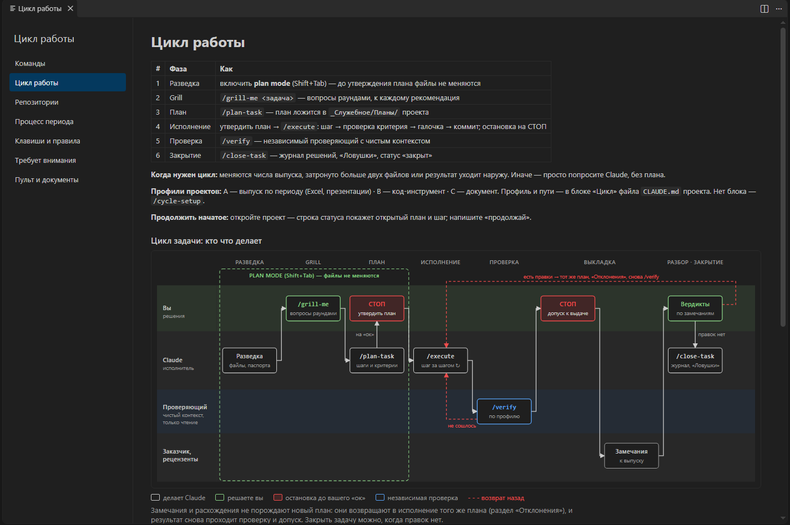
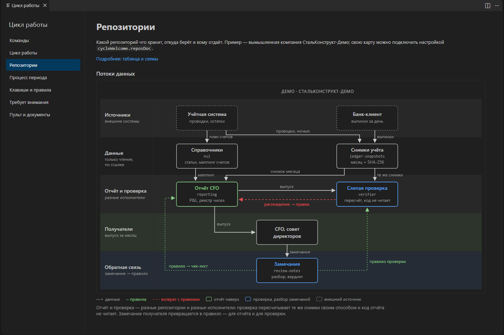
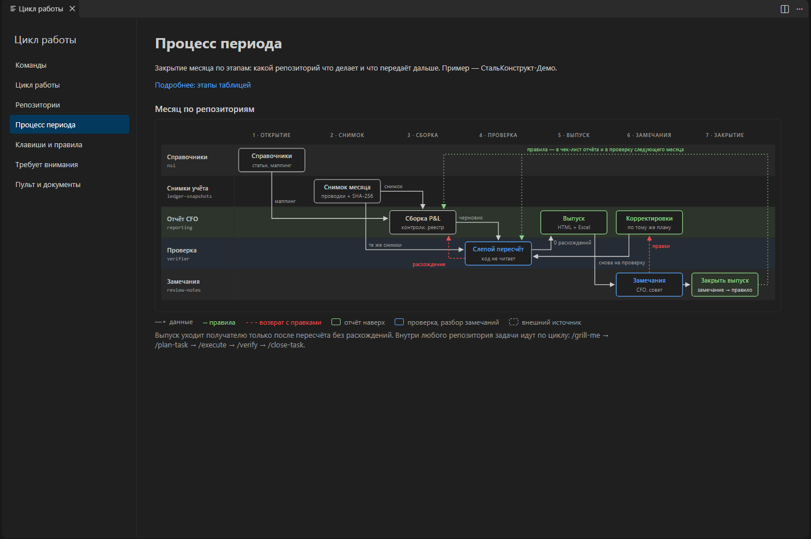
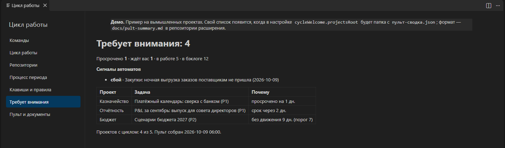

# «Цикл работы» — внутренний контроль для работы с AI-агентом

[](https://github.com/till2718281828/claude-cycle-vscode/actions/workflows/ci.yml)

[Что работает сразу](#что-работает-сразу) · [Установка](#установка) · [Настройки](#настройки) · [Сводка пульта](docs/pult-summary.md) · [English](#english)

Система внутреннего контроля финансовой службы — регламент, разделение исполнителя и проверяющего,
след каждого решения — перенесённая на работу с AI-агентами и вынесенная на экран. Я финансовый директор;
по этому регламенту я каждый день ставлю задачи Claude Code и принимаю результат.

Технически это расширение VS Code: в каждом новом окне оно открывает вкладку «Цикл работы». На ней видно,
по каким фазам идёт задача, где решает человек, где агент обязан остановиться, кто проверяет результат и
что сейчас ждёт решения. Встроенные схемы нарисованы на вымышленной компании СтальКонструкт-Демо.



*Фазы задачи по исполнителям: решения и «ок» — за человеком (зелёное и красное), работа — за Claude,
проверка — за отдельным проверяющим с чистым контекстом. Замечания возвращают в тот же план, а не порождают новый.*

## Зачем

AI-агент похож на сильного новичка: работает быстро, а без регламента ошибается тихо. Финансовая служба
давно страхует людей регламентом, разделением исполнителя и проверяющего и следом каждого решения.
Здесь та же система применена к агенту:

- **регламент** — задача проходит фазы: разведка → вопросы постановщику → план → исполнение по шагам →
  независимая проверка → закрытие с журналом решений;
- **точки остановки** — план утверждает человек, выдачу результата тоже; на таких точках агент
  останавливается и ждёт «ок»;
- **четыре глаза** — проверяет не тот, кто делал: отдельный агент с чистым контекстом, только чтение;
- **что горит** — раздел «Требует внимания»: просроченное, ждущее решения, сигналы автоматов.

Вкладка ничего не делает за агента. Она держит правила на виду у того, кто ставит задачи и принимает результат.

## Что на вкладке

| Раздел | Что показывает |
|---|---|
| Команды | команды цикла и полезные команды Claude Code |
| Цикл работы | фазы задачи и схема «кто что делает»: вы, Claude, проверяющий, заказчик |
| Репозитории | какой репозиторий что хранит и кому отдаёт — [демо-пример](docs/repos.md) |
| Процесс периода | закрытие месяца по этапам и репозиториям |
| Клавиши и правила | plan mode, утверждение плана, какие действия запрещены агенту |
| Требует внимания | сводка по всем проектам; без неё — демо |
| Пульт и документы | ссылки на пульт, README плагина, план цикла, карту репозиториев |



*Отчёт и его проверка — разные репозитории и разные исполнители: проверка пересчитывает те же исходные
данные своим способом и код отчёта не читает. Замечание получателя становится правилом — для отчёта и для проверки.*



*Выпуск уходит наверх только после независимого пересчёта без расхождений; правки по замечаниям снова проходят
проверку, а каждое принятое замечание становится правилом следующего месяца.*



*Что ждёт решения по всем проектам сразу: просрочка, задачи на остановке, сигналы автоматов. На снимке — демо.*

## Из практики

Вкладкой я пользуюсь каждый день в работе финансовым директором группы компаний. По этому циклу у меня
идут задачи в разных проектах: регулярная отчётность наверх, расчёты, внутренние инструменты. В рабочей
версии на вкладке схемы моего контура; здесь они заменены демо-примером, механизм тот же.

Пример того, что получается по этому циклу, — открытый репозиторий
[ai-management-reporting](https://github.com/till2718281828/ai-management-reporting): управленческий P&L с
реестром чисел и слепой проверкой агентом. Он собран этим же циклом: план, разбор решений, исполнение по
шагам с проверкой критерия на каждом, независимая проверка результата, журнал решений.

## Что работает сразу

Команды на вкладке (`/plan-task`, `/execute`, `/verify` и другие) — из моего плагина цикла для Claude Code;
он готовится к публикации отдельным репозиторием. Поэтому сейчас:

| Сразу после установки | Нужно своё |
|---|---|
| фазы, правила и схемы — как памятка | команды цикла — появятся с плагином |
| проектные разделы — свои тексты и схемы на вкладке | «Требует внимания» по вашим проектам — нужен `пульт-сводка.json` от вашего скрипта по [контракту](docs/pult-summary.md); без него — демо |
| встроенная карта репозиториев-примера | пульт и ссылки на документы — укажите пути в [настройках](#настройки) |

**Пульт** — HTML-страница статуса задач по всем проектам; её и `пульт-сводка.json` строит внешний скрипт,
который обходит проекты и их планы. В этот репозиторий он не входит.

## Установка

Нужен VS Code 1.85 или новее.

1. Скачайте `claude-cycle-vscode-<версия>.vsix` со страницы
   [Releases](https://github.com/till2718281828/claude-cycle-vscode/releases).
2. Установите командой (подставьте версию) или в VS Code: Extensions → «…» → **Install from VSIX…**

   ```bash
   code --install-extension claude-cycle-vscode-<версия>.vsix
   ```

3. Выполните `Developer: Reload Window` — вкладка откроется сама. Открыть вручную — команда
   **«Цикл: памятка»** в палитре (Ctrl+Shift+P).

Собрать из исходников (нужен Node.js 20+):

```bash
git clone https://github.com/till2718281828/claude-cycle-vscode
cd claude-cycle-vscode
npm test            # все тесты зелёные
npm run package     # → claude-cycle-vscode-<версия>.vsix
```

## Настройки

Все пути по умолчанию пустые: ссылка на документ появляется, когда документ указан.

| Настройка | Что |
|---|---|
| `cycleWelcome.showOnStartup` | открывать вкладку в каждом новом окне (по умолчанию да) |
| `cycleWelcome.projectsRoot` | общая папка, в которой лежат ваши проекты; в ней ищутся `пульт.html` и `пульт-сводка.json`, от неё считаются относительные пути ниже |
| `cycleWelcome.readmePath` | README плагина цикла |
| `cycleWelcome.planPath` | план цикла — решения по процессу с обоснованием |
| `cycleWelcome.reposDoc` | своя карта репозиториев (Markdown); пусто — встроенный [демо-пример](docs/repos.md) |
| `cycleWelcome.projectSections` | проектные разделы — только в настройках `.code-workspace` |

**Режим ограниченного доступа.** В недоверенной папке вкладка работает, но настройки путей и проектных
разделов берутся только из пользовательских настроек: чужая папка не может подставить свой путь.

### Сводка пульта

Раздел «Требует внимания» читает `пульт-сводка.json` из папки проектов. Формат с примером —
[docs/pult-summary.md](docs/pult-summary.md). Сломанный файл не роняет вкладку: вместо раздела выводится
текст ошибки.

### Проектные разделы

Проект может добавить на вкладку свой раздел, видимый только в окне его workspace. В `settings` файла
`.code-workspace` укажите пути к JSON-описаниям (от папки файла workspace; пользовательская настройка
не считается):

```json
"cycleWelcome.projectSections": ["docs/памятка/раздел.json"]
```

Описание раздела, пути — от папки JSON:

```json
{
  "id": "close", "title": "Закрытие месяца", "after": "period",
  "md": "Закрытие месяца.md", "tail": "правила.md",
  "figs": [{ "svg": "конвейер.svg", "title": "Конвейер выпуска", "caption": "Подпись под схемой", "legend": true }],
  "links": [{ "title": "Репозитории", "step": "repos" }, { "title": "Состояние выпуска", "file": "../../Периоды/*/Состояние выпуска.md" }]
}
```

| Поле | Обязательно | Что |
|---|---|---|
| `id` | да | латинские буквы, цифры, `_` и `-`; не совпадает со встроенными |
| `title` | да | название в списке разделов |
| `md` | да | Markdown-текст раздела — над схемами |
| `after` | нет | id раздела, за которым вставить (`commands`, `cycle`, `repos`, `period`, `rules`, `attention`, `links`); неизвестный или пустой — в конец |
| `figs` | нет | схемы SVG: `svg` — файл, `title` — заголовок над схемой, `caption` — подпись под ней, `legend` — легенда |
| `tail` | нет | Markdown под схемами — карточки правил |
| `links` | нет | ссылки под текстом: `step` — перейти к разделу вкладки, `file` — открыть файл проекта (Markdown — в предпросмотре); `*` в пути — последняя по имени папка, где файл есть |

**Легенда.** `legend: true` — легенда цикла задачи, `"map"` — легенда карт. SVG рисуется на CSS-переменных
вкладки (`var(--ink)`, `--accent`, `--stop`, `--check` …), поэтому подстраивается под светлую и тёмную тему.
При `legend: true` цвет рамки — это смысл: `--ink` — делает Claude или скрипт, `--accent` — решаете вы,
`--stop` с заливкой `--stop-soft` — остановка до вашего «ок», `--check` — независимая проверка; красный
пунктир — возврат назад.

JSON не найден или сломан — раздел показывается с текстом ошибки, остальная вкладка работает.

## Что внутри

| Путь | Что |
|---|---|
| `extension.js` | вкладка: разметка, команды, связь с VS Code |
| `встроенные-разделы.js` | состав вкладки — разделы, схемы, ссылки |
| `настройки.js` · `сводка.js` · `проектные-разделы.js` | логика без VS Code: пути документов, раздел «Требует внимания», проектные разделы |
| `media/` | тексты разделов и схемы SVG |
| `docs/` | контракт сводки, демо-карта репозиториев, скриншоты |
| `test/` | `node --test`: пути и настройки, сводка и демо, проектные разделы, целостность вкладки, отсутствие личных путей |

---

## English

**"Work cycle": internal control for working with an AI agent.** A finance function's internal control —
a protocol, segregation of the doer and the reviewer, an audit trail of every decision — applied to AI
agents and put on screen. I am a CFO and I run my daily work with Claude Code by this protocol.

Technically, it is a VS Code extension that opens a "Work cycle" tab in every new window: the phases of a
task (discovery → questions to the requester → plan → step-by-step execution → independent review →
close-out with a decision log), where a human decides, where the agent must stop for an "ok", who reviews
the result, and what needs attention across projects. The built-in diagrams use a fictional company.

Works right away: phases, rules and diagrams as a reference, and your own project sections. The cycle
commands come from my Claude Code plugin, which will be published separately; "Needs attention" shows your
projects when your own script writes a JSON summary ([format](docs/pult-summary.md)), otherwise a demo.

An example of work done in this cycle: [ai-management-reporting](https://github.com/till2718281828/ai-management-reporting).
Install: download the `.vsix` from Releases and run `code --install-extension claude-cycle-vscode-<version>.vsix`
(or Extensions → "…" → Install from VSIX). The interface is in Russian.

---

Владимир Лобанов, финансовый директор · [профиль на GitHub](https://github.com/till2718281828) ·
пример работы этим циклом — [ai-management-reporting](https://github.com/till2718281828/ai-management-reporting) ·
лицензия MIT.
