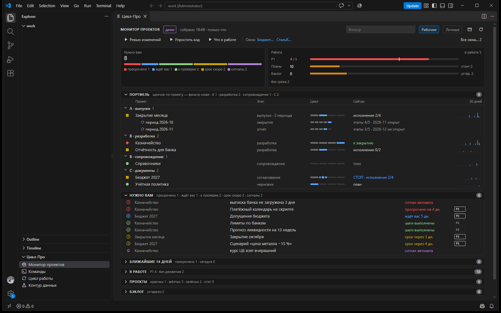

# «Цикл-Про» — внутренний контроль для работы с AI-агентом

[](https://github.com/till2718281828/claude-cycle-vscode/actions/workflows/ci.yml)

[Что нового в 2.0](#что-нового-в-20) · [Что работает сразу](#что-работает-сразу) · [Установка](#установка) · [Настройки](#настройки) · [English](#english)

Система внутреннего контроля финансовой службы — регламент, разделение исполнителя и проверяющего,
след каждого решения — перенесённая на работу с AI-агентами и вынесенная на экран. По этому регламенту
я каждый день ставлю задачи Claude Code и принимаю результат.

Технически это расширение VS Code: в каждом новом окне оно открывает вкладку «Цикл-Про». Первым на ней —
**монитор проектов**: что ждёт вашего решения, что просрочено, что стоит без движения, на какой фазе каждая
задача. Ниже — команды, фазы цикла и контур данных. Без настроек монитор показывает вымышленную компанию
СтальКонструкт-Демо.



*Монитор собирается из обычных файлов проектов — шапок планов, их шагов, бэклога, git и сессий Claude Code.
Причины внимания считаются по правилам: просрочено, ждёт вашего «ок», шаги выполнены и пора проверять, срок скоро.*

## Зачем

AI-агент похож на сильного новичка: работает быстро, а без регламента ошибается тихо. Финансовая служба
давно страхует людей регламентом, разделением исполнителя и проверяющего и следом каждого решения.
Здесь та же система применена к агенту:

- **регламент** — задача проходит фазы: разведка → вопросы постановщику → план → исполнение по шагам →
  независимая проверка → закрытие с журналом решений;
- **точки остановки** — план утверждает человек, выдачу результата тоже; на таких точках агент
  останавливается и ждёт «ок»;
- **четыре глаза** — проверяет не тот, кто делал: отдельный агент с чистым контекстом, только чтение;
- **что горит** — монитор по всем проектам: просроченное, ждущее решения, застрявшее, сигналы автоматов.

Вкладка ничего не делает за агента. Она держит правила и состояние работы на виду у того, кто ставит задачи
и принимает результат.

## Что нового в 2.0

| Было в 1.x | Стало в 2.0 |
|---|---|
| «Требует внимания» — сводка из внешнего JSON | **монитор проектов** со своим сборщиком: шкалы, портфель по фазам, «нужно вам», сроки на 14 дней, планы, проекты, бэклог |
| только памятка | **кнопки**: запрос в Claude Code или терминал в папке проекта — Enter за вами |
| список разделов слева во вкладке | **панель «Цикл-Про» в Explorer**; вкладка целиком отдана содержимому |
| семь разделов | четыре: монитор, команды, цикл работы, контур данных |
| — | **модуль серверов** (по желанию): порты своих серверов, диск и память машины |
| «Цикл работы — памятка» | «Цикл-Про» |

## Что на вкладке

| Раздел | Что показывает |
|---|---|
| Монитор проектов | шкалы «Нужно вам» и «Работа» (лимит P1), портфель по профилям и фазам, конвейеры периодов, «нужно вам», ближайшие 14 дней, планы в работе, здоровье проектов, бэклог, ошибки в данных |
| Команды | команды вне цикла, плагин диаграмм, команды Claude Code; ссылки на README, монитор в браузере и ваши документы |
| Цикл работы | фазы задачи и команды цикла, профили проектов, схемы «кто что делает» и «один шаг», клавиши и правила |
| Контур данных | какой репозиторий что хранит, откуда берёт и кому отдаёт, и как по ним проходит месяц — [демо-пример](docs/repos.md) |


*Решения и «ок» — за человеком, работа — за Claude, проверка — за отдельным проверяющим с чистым контекстом.
Замечания возвращают в тот же план, а не порождают новый.*


*Отчёт и его проверка — разные репозитории и разные исполнители: проверка пересчитывает те же исходные данные
своим способом и код отчёта не читает. Замечание получателя становится правилом — для отчёта и для проверки.*

## Из практики

Вкладкой я пользуюсь каждый день в работе финансовой службы группы компаний. По этому циклу у меня идут
задачи в разных проектах: регулярная отчётность наверх, расчёты, внутренние инструменты. В рабочей версии
монитор смотрит на мои проекты, а контур — на мои репозитории; здесь они заменены демо, механизм тот же.

Пример того, что получается по этому циклу, — открытый репозиторий
[ai-management-reporting](https://github.com/till2718281828/ai-management-reporting): управленческий P&L с
реестром чисел и слепой проверкой агентом. Он собран этим же циклом: план, разбор решений, исполнение по
шагам с проверкой критерия на каждом, независимая проверка результата, журнал решений.

## Что работает сразу

| Сразу после установки | Нужно своё |
|---|---|
| монитор на демо: семь проектов СтальКонструкт-Демо во всех состояниях ([что показывает каждый](demo/README.md)) | монитор по вашим проектам — настройка `cycleWelcome.projectsRoot` |
| фазы, правила и схемы — как памятка | Python 3.10+ для сборщика монитора (обычно уже есть) |
| общие кнопки монитора: `/code-review`, `/simplify`, «Что в работе» | кнопки задач (`/cycle:execute`, `/cycle:verify` …) и команды цикла — нужен мой плагин цикла для Claude Code; он готовится к публикации отдельным репозиторием |
| проектные разделы — свои тексты и схемы на вкладке | серверы на мониторе — список в `cycleWelcome.servers` |

**Как монитор видит проект.** Проект — папка в папке проектов. Цикл подключён, если в её `CLAUDE.md` есть раздел
`## Цикл` с YAML-блоком (`профиль`, `планы`, `бэклог`). План — Markdown со шапкой `статус`, `приоритет`, `срок`,
`ждёт` и шагами `- [ ]` / `- [x]` в разделе `## Шаги`; бэклог — таблица `Задача | Приоритет | Срок | Создана | Примечание`.
Посмотреть на живом примере — папка [demo/](demo/). Сигналы своих автоматов проект кладёт в
`_Служебное/сигналы.json`: `[{"текст", "уровень": "warn"|"crit", "дата"}]`.

## Установка

Нужен VS Code 1.85 или новее; для монитора — Python 3.10+. Заявлены Windows, macOS и Linux; проверено на Windows.

1. Скачайте `claude-cycle-vscode-<версия>.vsix` со страницы
   [Releases](https://github.com/till2718281828/claude-cycle-vscode/releases).
2. Установите командой (подставьте версию) или в VS Code: Extensions → «…» → **Install from VSIX…**

   ```bash
   code --install-extension claude-cycle-vscode-<версия>.vsix
   ```

3. Выполните `Developer: Reload Window` — вкладка откроется сама, на мониторе с демо. Открыть вручную —
   команда **«Цикл-Про: открыть»** в палитре (Ctrl+Shift+P).

Собрать из исходников (нужны Node.js 20+ и Python 3.10+):

```bash
git clone https://github.com/till2718281828/claude-cycle-vscode
cd claude-cycle-vscode
npm test                      # тесты вкладки
python -m pytest пульт -q     # тесты сборщика монитора на demo/
npm run package               # → claude-cycle-vscode-<версия>.vsix
```

## Настройки

Настраивать ничего не нужно: без настроек вкладка показывает монитор на демо, памятку и схемы.

| Настройка | Что даёт |
|---|---|
| `cycleWelcome.projectsRoot` | папка ваших проектов — монитор смотрит на неё вместо демо |
| `cycleWelcome.pythonPath` | Python для сборщика, если он не `python` (Windows) или `python3` (macOS, Linux) |
| `cycleWelcome.personalProjects` | личные проекты: скрыты, пока не нажата кнопка «Личные» |
| `cycleWelcome.hiddenProjects` | папки, которые монитор не показывает (папки на `.` и `_` скрыты всегда) |
| `cycleWelcome.p1Limit` | лимит P1 в работе (5): выше — красное число |
| `cycleWelcome.thresholds` | пороги в днях: `в_работе_дней` 7, `ждёт_вас_дней` 2, `утверждён_не_начат_дней` 7, `бэклог_P1_P2_дней` 14, `бэклог_P3_дней` 90, `срок_скоро_дней` 7 |
| `cycleWelcome.pipelines` | конвейеры периодов — см. ниже |
| `cycleWelcome.commandsFile` | свои общие кнопки монитора вместо встроенных |
| `cycleWelcome.servers` | серверы, порты которых проверяет монитор: `[{"name", "host", "port", "purpose"}]` |
| `cycleWelcome.checkMachine` | показывать свободные диск и память этой машины в блоке «Серверы» |
| `cycleWelcome.links` | свои документы в разделе «Команды» — список `{"title", "path"}` |
| `cycleWelcome.showOnStartup` · `cycleWelcome.navInTab` | автопоказ вкладки · меню разделов внутри вкладки |
| `cycleWelcome.projectSections` | свои разделы проекта — см. [«Проектные разделы»](#проектные-разделы) |

```json
"cycleWelcome.projectsRoot": "/home/me/Projects",
"cycleWelcome.personalProjects": ["Дом", "Обучение"],
"cycleWelcome.servers": [{ "name": "Учёт", "host": "10.0.0.5", "port": 5432, "purpose": "база учётной системы" }],
"cycleWelcome.links": [{ "title": "План цикла", "path": "plugin/план-цикла.md" }]
```

**Конвейер периода.** Для проекта с ежемесячным выпуском монитор рисует этапы каждого открытого периода. Период —
подпапка `ГГГГ-ММ` в папке периодов; этап пройден, если в папке периода есть файл по маске (пустая маска — пройден всегда):

```json
"cycleWelcome.pipelines": {
  "Закрытие месяца": { "папка": "Периоды",
    "этапы": [["открытие", ""], ["источники", "Источники/*"], ["расчёт", "Расчёты/*"], ["отчёт", "Отчёт/*"], ["закрытие", "закрыт.md"]] }
}
```

**Кнопки.** Общие кнопки — `пульт/команды.json` расширения или ваш файл из `cycleWelcome.commandsFile`; свои у проекта —
`<проект>/_Служебное/команды.json`. Формат: `[{"id", "название", "запрос", "подтвердить"?, "подсказка"?}]`;
`подтвердить: true` — сначала вопрос «Запустить?». Общая кнопка открывает вкладку Claude Code с набранным запросом,
кнопка проекта — терминал в его папке с набранной командой `claude '<запрос>'`; Enter — за вами. Кавычки подбираются
под оболочку терминала (PowerShell, cmd, bash/zsh, fish); в незнакомую оболочку запрос не набирается, а копируется.

**Безопасность.** Webview присылает расширению только id и пути; команда, файл и окно берутся из данных монитора,
подменённый запрос не исполняется. В недоверенной папке настройки путей, Python, серверов, конвейеров и кнопок
берутся только из пользовательских настроек: чужая папка не может подставить свою программу или путь.

### Проектные разделы

Проект может добавить на вкладку свой раздел, видимый только в окне его workspace. В `settings` файла
`.code-workspace` укажите пути к JSON-описаниям (от папки файла workspace; пользовательская настройка
не считается):

```json
"cycleWelcome.projectSections": ["docs/памятка/раздел.json"]
```

Описание раздела, пути — от папки JSON:

```json
{
  "id": "close", "title": "Закрытие месяца", "after": "repos",
  "md": "Закрытие месяца.md", "tail": "правила.md",
  "figs": [{ "svg": "конвейер.svg", "title": "Конвейер выпуска", "caption": "Подпись под схемой", "legend": true }],
  "links": [{ "title": "Контур данных", "step": "repos" }, { "title": "Состояние выпуска", "file": "../../Периоды/*/Состояние выпуска.md" }]
}
```

| Поле | Обязательно | Что |
|---|---|---|
| `id` | да | латинские буквы, цифры, `_` и `-`; не совпадает со встроенными |
| `title` | да | название в панели и на вкладке |
| `md` | да | Markdown-текст раздела — над схемами |
| `after` | нет | id раздела, за которым вставить (`pult`, `commands`, `cycle`, `repos`; прежние id 1.x тоже понимаются); неизвестный или пустой — в конец |
| `figs` | нет | схемы SVG: `svg` — файл, `title` — заголовок над схемой, `caption` — подпись под ней, `legend` — легенда |
| `tail` | нет | Markdown под схемами — карточки правил |
| `links` | нет | ссылки под текстом: `step` — перейти к разделу вкладки, `file` — открыть файл проекта (Markdown — в предпросмотре); `*` в пути — последняя по имени папка, где файл есть |

На странице раздела видно и «Сейчас» этого проекта из монитора: конвейеры, фаза цикла, сигналы.

**Легенда.** `legend: true` — легенда цикла задачи, `"map"` — легенда карт. SVG рисуется на CSS-переменных
вкладки (`var(--ink)`, `--accent`, `--stop`, `--check` …), поэтому подстраивается под светлую и тёмную тему.
При `legend: true` цвет рамки — это смысл: `--ink` — делает Claude или скрипт, `--accent` — решаете вы,
`--stop` с заливкой `--stop-soft` — остановка до вашего «ок», `--check` — независимая проверка; красный
пунктир — возврат назад.

JSON не найден или сломан — раздел показывается с текстом ошибки, остальная вкладка работает.

## Ограничения

- Монитор пересобирается при открытии вкладки, на другой день и по кнопке «Пересобрать» — не на каждое
  изменение файла.
- Кнопки задач предполагают плагин цикла; без него Claude Code ответит, что команды нет.
- Сессии Claude Code считаются по журналам `~/.claude/projects` (или `$CLAUDE_CONFIG_DIR/projects`).
- Интерфейс — на русском.

## Что внутри

| Путь | Что |
|---|---|
| `extension.js` | вкладка, панель в Explorer, запуск сборщика, мост действий монитора |
| `пульт/собрать.py` | сборщик монитора: читает проекты, считает причины, здоровье и счётчики; `пороги.json`, `команды.json` — значения по умолчанию |
| `пульт/пульт.js` · `пульт.css` · `шаблон.html` | рендерер монитора — общий для вкладки и браузерной страницы |
| `встроенные-разделы.js` · `панель-разделов.js` · `проектные-разделы.js` | состав вкладки, дерево панели, проектные разделы |
| `команды.js` · `настройки.js` · `источники.js` | мост действий и кавычки терминала · настройки · модуль серверов |
| `demo/` | семь проектов СтальКонструкт-Демо — монитор без настроек и эталон тестов |
| `media/` · `docs/` | тексты разделов и схемы · демо-карта репозиториев, скриншоты |
| `test/` · `пульт/test_собрать.py` | `node --test` и pytest: мост и кавычки, настройки, серверы, панель, разделы, сборщик на демо, отсутствие личных путей |

Изменения по версиям — [CHANGELOG.md](CHANGELOG.md).

---

## English

**"Цикл-Про" (Cycle Pro): internal control for working with an AI agent.** A finance function's internal
control — a protocol, segregation of the doer and the reviewer, an audit trail of every decision — applied to AI
agents and put on screen. I run my daily work with Claude Code by this protocol.

Technically, it is a VS Code extension that opens a tab in every new window. First comes a **project monitor**
built from plain project files (plan headers and checkboxes, backlog tables, git, Claude Code sessions): what
waits for your decision, what is overdue, what is stuck, which phase each task is in. Below it: commands, the
task cycle (discovery → questions → plan → step-by-step execution → independent review → close-out) and the
data contour. Buttons open Claude Code with a pre-typed prompt or a terminal in the project folder — Enter is yours.

Works right away on a fictional demo company; point `cycleWelcome.projectsRoot` at your projects folder to see
your own. Requires VS Code 1.85+ and Python 3.10+. Task buttons (`/cycle:*`) need my Claude Code cycle plugin,
which will be published separately.

An example of work done in this cycle: [ai-management-reporting](https://github.com/till2718281828/ai-management-reporting).
Install: download the `.vsix` from Releases and run `code --install-extension claude-cycle-vscode-<version>.vsix`
(or Extensions → "…" → Install from VSIX). The interface is in Russian.

---

Владимир Лобанов · [профиль на GitHub](https://github.com/till2718281828) ·
пример работы этим циклом — [ai-management-reporting](https://github.com/till2718281828/ai-management-reporting) ·
лицензия MIT.
